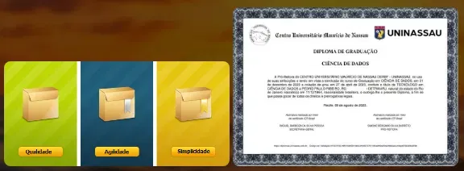

# 🤖 Deep Q-Network — Aprendizado por Reforço em Python
### Dashboard Flask: **Computação Clássica** vs **Computação Quântica**

📞 **Meus Contatos:** [www.inforpop.com](https://www.inforpop.com)
📱 WhatsApp: [55 21 99961-8643](https://wa.me/5521999618643)
✉️ Email: [inforpop@hotmail.com](mailto:inforpop@hotmail.com)
🔗 LinkedIn: [Pedro Paulo Ribeiro](https://www.linkedin.com/in/pedro-paulo-ribeiro-pcd-1451498/)



---

## 📌 Sobre o projeto

Projeto prático que implementa do zero o algoritmo **Deep Q-Network (DQN)** — o método da DeepMind
que aprendeu a jogar Atari — e o compara com uma versão **quântica**, em que a rede neural é substituída
por um **Circuito Quântico Variacional (VQC)** de 4 qubits.

Tudo é escrito em **NumPy puro** (sem PyTorch, TensorFlow, Gym ou Qiskit), o que mantém o deploy no
Heroku leve e torna cada etapa do algoritmo visível no código.

| | 🖥️ Aba Clássica | ⚛️ Aba Quântica |
|---|---|---|
| Aproximador de Q | MLP (2 camadas ocultas, ReLU) | VQC: RX·RY·RZ por qubit + anel de CNOTs |
| Gradiente | Retropropagação | **Regra do deslocamento de parâmetros** (exata) |
| Otimizador | Adam | Adam |
| Ambientes | CartPole · GridWorld 4×4 | GridWorld 4×4 · CartPole (experimental) |
| Parâmetros | ~1.700 a 4.600 | **~44** |

### Componentes da DQN
- **Experience Replay** — memória circular de transições (s, a, r, s′)
- **Rede-alvo** sincronizada a cada N passos
- **Double DQN** — a rede online escolhe a ação, a rede-alvo avalia
- **Perda de Huber** sobre o erro TD
- **Exploração ε-greedy** com decaimento por episódio
- **Melhor modelo** guardado durante o treino (média móvel de 20 episódios)

### Parte quântica
- Simulador de **vetor de estado** vetorizado (milhares de circuitos por chamada)
- **Codificação de base**: o estado `s ∈ {0..15}` vira `|s⟩` em 4 qubits
- **Data re-uploading** (Skolik et al., 2022): o estado é reinserido a cada camada
- Saída: `Q(s,a) = w_a · ⟨Z_a⟩ + b_a`
- Visualização do circuito e das probabilidades `|⟨i|ψ(s)⟩|²` do estado treinado

## 📊 O dashboard
- Formulário de hiperparâmetros (episódios, taxa de aprendizado, γ, ε, lote, camadas…)
- Indicadores: episódio, média móvel, melhor média, ε, nº de parâmetros, tempo
- Gráficos em tempo real: recompensa + média móvel, perda TD e ε
- **Política aprendida**: setas no GridWorld com a trajetória, ou animação do CartPole
- **Aba quântica**: diagrama do circuito e histograma do vetor de estado

O treino roda numa *thread* em segundo plano e o navegador consulta o progresso a cada 0,8 s —
isso evita o limite de 30 s por requisição do Heroku.

## 🗂️ Estrutura
```
dqn-dashboard/
├── app.py                 # Servidor Flask e API
├── rl/
│   ├── envs.py            # CartPole e GridWorld (NumPy)
│   ├── replay.py          # Experience Replay
│   ├── classical_dqn.py   # MLP + Adam + Huber + Double DQN
│   ├── quantum.py         # Simulador de vetor de estado + VQC
│   ├── quantum_dqn.py     # DQN com circuito quântico
│   └── trainer.py         # Treinos em segundo plano
├── templates/index.html   # Dashboard (2 abas)
├── static/css, js, img    # Estilo, Chart.js e imagem
├── Procfile               # gunicorn para o Heroku
├── requirements.txt
├── .python-version        # Versão do Python para o Heroku
└── app.json
```

## ▶️ Rodar localmente
```bash
python -m venv .venv
source .venv/bin/activate        # Windows: .venv\Scripts\activate
pip install -r requirements.txt
python app.py                    # http://localhost:5000
```

## ☁️ Implantação no Heroku
Pré-requisitos: conta no Heroku, [Heroku CLI](https://devcenter.heroku.com/articles/heroku-cli) e Git.

```bash
cd dqn-dashboard
git init
git add .
git commit -m "DQN clássica vs quântica"

heroku login
heroku create dqn-classico-quantico      # escolha um nome disponível
git push heroku main                      # ou: git push heroku master
heroku open
heroku logs --tail                        # acompanhar os logs
```

> O `Procfile` usa **1 worker** com várias threads, porque os treinos ficam na memória do processo.
> Se o dyno reiniciar, os treinos em andamento são perdidos (basta treinar de novo).
> O servidor limita a 3 treinos simultâneos.

## 🔌 API
| Método | Rota | Descrição |
|---|---|---|
| POST | `/api/train` | `{mode, env, config, seed}` → `job_id` |
| GET | `/api/status/<id>?since=n` | progresso incremental |
| POST | `/api/stop/<id>` | interrompe o treino |
| GET | `/api/policy/<id>` | política gulosa (grade ou quadros do CartPole) |
| GET | `/api/statevector/<id>?s=0` | probabilidades do estado quântico |
| GET | `/api/circuit?layers=3&env=gridworld` | estrutura do circuito |
| GET | `/api/defaults` | hiperparâmetros padrão |

## 📚 Referências
- Mnih et al. (2015). *Human-level control through deep reinforcement learning*. Nature.
- van Hasselt, Guez & Silver (2016). *Deep Reinforcement Learning with Double Q-learning*.
- Chen et al. (2020). *Variational Quantum Circuits for Deep Reinforcement Learning*.
- Skolik, Jerbi & Dunjko (2022). *Quantum agents in the Gym*.
- Mitarai et al. / Schuld et al. (2019). *Evaluating analytic gradients on quantum hardware* (regra do deslocamento).

---
Desenvolvido por **Pedro Paulo Ribeiro** — Cientista de Dados · [www.inforpop.com](https://www.inforpop.com)
